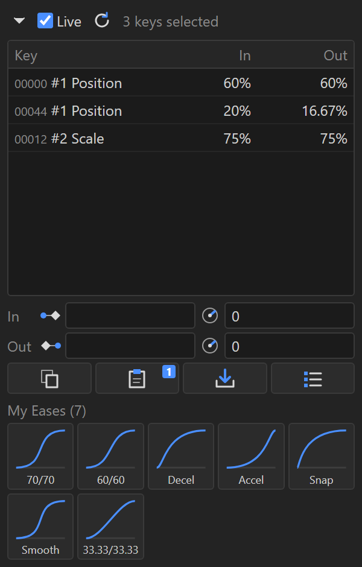

# After Effects Plugins

- [Ease Inspector](#ease-inspector) — `EaseInspector/`

## Ease Inspector

`EaseInspector/EaseInspector.zxp` (signed CEP extension) — source in `EaseInspector/com.josh.easeinspector/`

Dockable panel that shows the ease influence and speed of whatever keyframes you have selected, live, without opening the Keyframe Velocity dialog — plus quick editing, ease copy/paste, and a library of saved eases.

**What it does**

- Follows your keyframe selection live as you click around the timeline or Graph Editor: each selected key gets a row with its time, layer number, property, and In / Out influence (speed shown when it isn't 0, `L` for linear, `Hold` for hold keys). Properties with separate per-axis eases show each axis's value, e.g. `33.33/50/33.33`.
- Widen the panel past ~640 px and the list switches to the full layout: Property, Time, Interpolation, In %, In Speed, Out %, Out Speed.
- **In / Out fields** show the current values of the selected keys (blank when they differ). Type a value and press **Return** to apply — only the fields you changed are applied. **Esc** reverts. Click rows in the list (Ctrl/Shift-click for several) to target only those keys.
- **Copy / Paste** eases between keys: copy 2 keys and paste onto 2 others in order, or copy 1 key and paste it onto any number. Count mismatches are flagged before anything changes, and pasting between different properties (e.g. Position → Opacity) asks first, since speed is measured in each property's own units.
- **Save** stores one keyframe's ease in the library. Library tiles show each ease's curve — click a tile to apply it to the selected keys, drag tiles to reorder, hover to see the exact values.
- Ease names are optional: leave the name blank and the tile shows the values (e.g. `70/70`) and follows them as you edit; type a name (e.g. `Snap`) to label it instead.
- **Manage** opens the library view inside the panel: rename the library, add / edit / remove / reorder eases, **Export** a `.json` backup, **Import** a library (replace or add), or reset to defaults.
- Collapse the key list (triangle at the top left) for a compact view of just the fields, buttons, and library.
- Every edit is a single undo step.

**Install**

1. Install `EaseInspector.zxp` with a ZXP installer, such as [ZXP/UXP Installer](https://aescripts.com/learn/zxp-installer/) (free) or Anastasiy's Extension Manager.
2. Restart After Effects, then open it from **Window > Extensions > Ease Inspector**.

**Usage**

1. Select keyframes anywhere in the timeline — the panel updates on its own.
2. Read values off the list, or type into the In / Out fields and press Return to change them.
3. Use **Copy** / **Paste** to move eases between keys, and **Save** to keep ones you reuse; click a library tile to apply it.

**Notes**

- **How it stays live:** After Effects doesn't tell extensions when the selection changes, so the panel checks about 4 times a second while keys are selected and less often when nothing is selected or the panel is hidden. Each check takes a fraction of a millisecond, and nothing runs while the panel is closed. Untick **Live** to stop checking entirely and use the refresh button instead.
- The library is stored in After Effects' preferences, not the project, so it's shared across all projects. Each AE version keeps its own copy — use Export / Import to move it between versions.
- Applying a library ease sets the key to Bezier. Speed values are in each property's own units, so a saved speed only means the same thing on similar properties.
- This is a CEP extension. Adobe is retiring CEP at the end of 2029 in favor of UXP; a UXP version is planned once After Effects' UXP support is out of beta.
- The `.zxp` is self-signed (certificate valid until October 2036) and not timestamped, so it needs re-signing before then.

Built and tested on After Effects 26.3 (Windows).

**Developer notes**

- `host.jsx` holds all After Effects-side logic (reading/writing eases, copy/paste, library storage); `main.js` is the panel UI. The panel talks to AE only through `evalScript`, so a call made while AE has a modal dialog open is simply retried instead of raising an error.
- To work on it without packaging: copy `com.josh.easeinspector/` to `%APPDATA%\Adobe\CEP\extensions\` and enable unsigned extensions by setting `PlayerDebugMode` = `1` under `HKEY_CURRENT_USER\Software\Adobe\CSXS.<version>`.
- To package a new version: bump both version numbers in `CSXS/manifest.xml`, then run `ZXPSignCmd -sign com.josh.easeinspector EaseInspector.zxp <cert.p12> <password>` (ZXPSignCmd is in Adobe's [CEP-Resources](https://github.com/Adobe-CEP/CEP-Resources/tree/master/ZXPSignCMD) repo). Never commit the certificate or its password. Version 4.1.103 crashes when given `-tsa`, which is why the package isn't timestamped.
