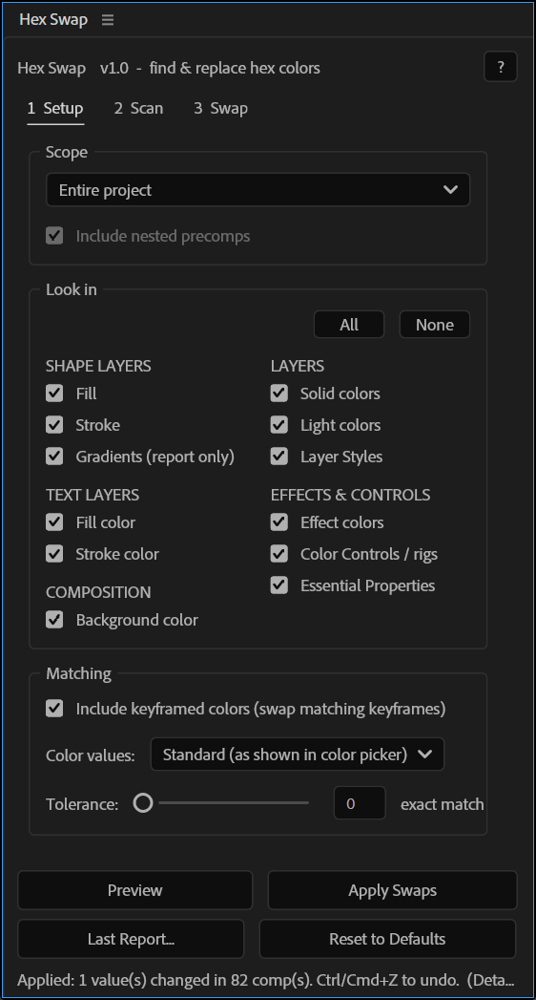
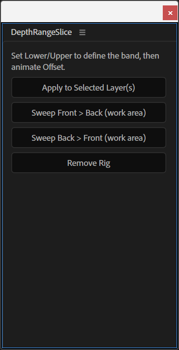
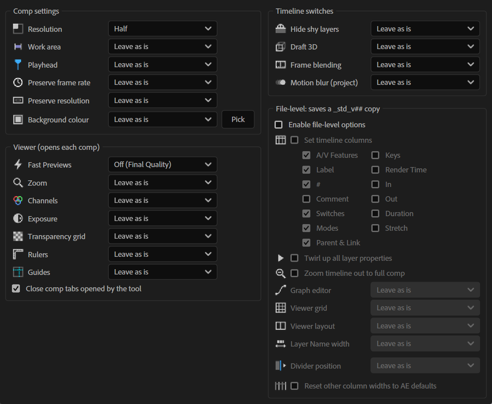

# After Effects Scripts

- [Hex Swap](#hex-swap) — `HexSwap.jsx`
- [Depth Range Slice](#depth-range-slice) — `DepthRangeSlice.jsx`
- [Reset Layer Time Offsets](#reset-layer-time-offsets) — `ResetLayerTimeOffsets.jsx`
- [Comp Standardizer](#comp-standardizer) — `CompStandardizer.jsx`, `CompStandardizerRun.jsx`

## Hex Swap

`HexSwap.jsx`

Dockable ScriptUI panel that finds colors by hex code across a project (or across the comps/folders selected in the Project panel) and swaps them in bulk.

**What it does**

- Scans shape fills/strokes (gradients report-only), text fill/stroke colors — including per-character and animator colors — comp backgrounds, solids, lights, layer styles, effect colors, Color Control/pseudo-effect rigs, and Essential Properties.
- Optionally includes nested precomps when scope is "Selected", and keyframed colors, with a per-channel tolerance slider (0–64) for near-matches.
- Two color modes: **Standard** (matches the color picker's stored value) or **Linear** (matches rendered output in linearized projects).
- Three-step workflow — **Scan** to survey, **Preview** to see what would change (opens a report), **Apply** to commit (wrapped in one undo group; status line points to **Last Report**, which can be copied or saved as `.txt`).
- Swap lists can be saved/loaded as `.json` or plain `#OLD > #NEW` `.txt`; all settings persist automatically via `app.settings`, with a **Reset to Defaults** button.
- Expressions are intentionally skipped and listed in the report rather than overwritten.

**Install**

Copy `HexSwap.jsx` to `<After Effects>/Support Files/Scripts/ScriptUI Panels/`, restart AE, then open it from **Window > HexSwap.jsx**. For **Copy**, **Save**, and **Load** to work, enable Preferences → Scripting & Expressions → "Allow Scripts to Write Files and Access Network".

**Usage**

1. Set scope (Entire Project or Project-panel selection) and which categories to search under **1 Setup**.
2. Run **2 Scan** to see what hex colors exist, or paste/build a swap list under **3 Swap**.
3. Click **Preview** to review the report, then **Apply Swaps** to commit.

Built and tested on After Effects 26.3 (Windows). See [HexSwapDeveloperNotes.md](HexSwapDeveloperNotes.md) for the internal code map, AE quirks discovered during development, and a testing hook — useful reading before extending the script.

 
 
 

---

## Depth Range Slice

`DepthRangeSlice.jsx`

ScriptUI panel that turns a rendered depth pass into an animated reveal/slice effect.

**What it does**

- Applies a Levels rig to the selected layer(s) that remaps a chosen band of grey values (the "Lower Grey" / "Upper Grey" sliders) in a depth pass to full black → full white, with an `Offset` control that shifts the band and a `Gamma` control for the falloff.
- The band is a fixed width, so animating `Offset` sweeps it through the depth range, past both ends — useful for reveals, X-ray-style sweeps, or depth-based wipes.
- **Sweep Front → Back** / **Sweep Back → Front** buttons auto-keyframe the offset across the comp's work area with eased in/out.
- **Remove Rig** cleanly strips all the added effects back off the layer.
- Works at any bit depth (values are normalized 0–1 internally).

**Install**

Copy `DepthRangeSlice.jsx` to `<After Effects>/Support Files/Scripts/ScriptUI Panels/`, restart AE, then open it from **Window > DepthRangeSlice.jsx**. It can also be run once via **File > Scripts > Run Script File**.

**Usage**

1. Render or import a depth pass (e.g. a Redshift/Arnold/V-Ray Z-depth AOV — see [AOV Set Depth](../Cinema4DScenes/README.md#aov-set-depth) for an example Redshift setup) as a layer.
2. Select the layer(s) and click **Apply to Selected Layer(s)**.
3. Adjust Lower/Upper Grey to set the band width and position, then animate `Offset` (or use the Sweep buttons).

 
 
 

---

## Reset Layer Time Offsets

`ResetLayerTimeOffsets.jsx`

No-UI utility script that moves every eligible layer's start time back to 0 and extends its in/out points to fill the comp, without changing the visible timing.

**What it does**

- Keeps every keyframe (and layer marker) at the same comp time it had before the shift, by reading and rewriting all keyed properties around the `startTime` change.
- Extends the in point to the start of the comp and the out point to the end, then fills the newly-exposed range on visible layers with 0% HOLD opacity keys — hidden before the original in point and after the original out point — so nothing becomes visible outside its original on-screen range.
- Skips video, image sequences, audio, precomps, cameras, and lights; layers with Time Remap keyframes are processed anyway. Nulls get the time reset but no opacity holds.
- If a layer has expressions, it's listed in a dialog before running so you can choose to move it, skip it, or cancel — time-based expressions (`time`, `wiggle`, `loopOut`, `inPoint`, etc.) may play differently after the shift.
- Reports what it did (or skipped, and why) per layer in an alert when finished, wrapped in a single undo group.

**Install**

Run once via **File > Scripts > Run Script File**, or copy `ResetLayerTimeOffsets.jsx` to `<After Effects>/Support Files/Scripts/` and restart AE to run it from **File > Scripts** each time.

**Usage**

1. Select the comp (make it active) and run the script — no selection of individual layers is needed, it scans every layer in the comp.
2. Review the alert report for any skipped layers or expression warnings.

 
 
 

---

## Comp Standardizer

`CompStandardizer.jsx`, `CompStandardizerRun.jsx`

Dockable ScriptUI panel that applies a consistent set of comp, viewer, and timeline settings across every comp in a project in one pass, plus a companion no-UI runner for triggering it from KBar with the last-saved settings.

**What it does**

- **Comp settings** — resolution, work area (reset to full comp), playhead position, "Preserve frame rate/resolution when nested", and background color, applied to every comp.
- **Timeline switches** — Hide Shy Layers, Draft 3D, Frame Blending, and (project-wide) Motion Blur, each settable to On/Off/Leave, or **Smart** (on only in comps that actually use that feature).
- **Viewer options** — Fast Previews mode, zoom, channels, exposure, transparency grid, rulers, and guides; opens each comp's viewer to apply them, then closes any tabs it opened.
- **File-level options** (opt-in, since AE doesn't expose these to scripts directly): timeline column visibility/widths, Layer Name column width (fixed or auto-fit to the longest layer name), the divider position between columns and the time graph, twirling up all layer properties, zooming timelines out to show the full comp, graph editor default, viewer grid, and viewer pane layout. These are applied by exporting the project to a temporary XML copy, patching it, and saving the result as a new `yourproject_std_v01.aep` next to the original — **your original `.aep` is never modified**.
- Every control has a hover tooltip explaining what it does; settings persist automatically via a JSON file in `Folder.userData`, with a **Defaults** button to reset them.
- `CompStandardizerRun.jsx` re-applies whatever settings were last saved by the panel, with no dialog — built for a KBar button or a repeatable one-click pass. It shows a summary alert only if the panel's "Summary after KBar run" option is checked, or if there were warnings.

**Install**

Copy both files to `<After Effects>/Support Files/Scripts/ScriptUI Panels/`, restart AE, then open **Window > CompStandardizer.jsx**. Choose your settings there first — `CompStandardizerRun.jsx` reuses whatever the panel last saved, and does nothing (just shows an alert) until the panel has been opened and configured once. For the file-level `.aep` export/save step to work, enable Preferences → Scripting & Expressions → "Allow Scripts to Write Files and Access Network".

**Usage**

1. Open the panel and set your desired Comp/Timeline/Viewer options; optionally enable **File-level options** and choose which of those to apply.
2. Click **Standardize All Comps** to run immediately, or save settings and trigger `CompStandardizerRun.jsx` later (e.g. from a KBar button) to repeat the same pass without opening the panel.
3. Review the alert for a summary of what changed and any warnings.
