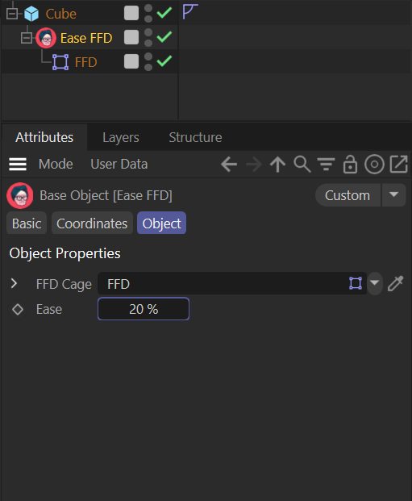
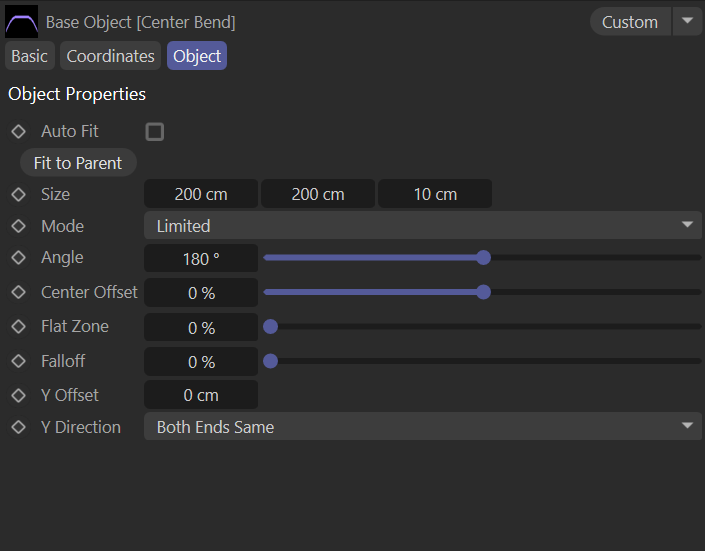
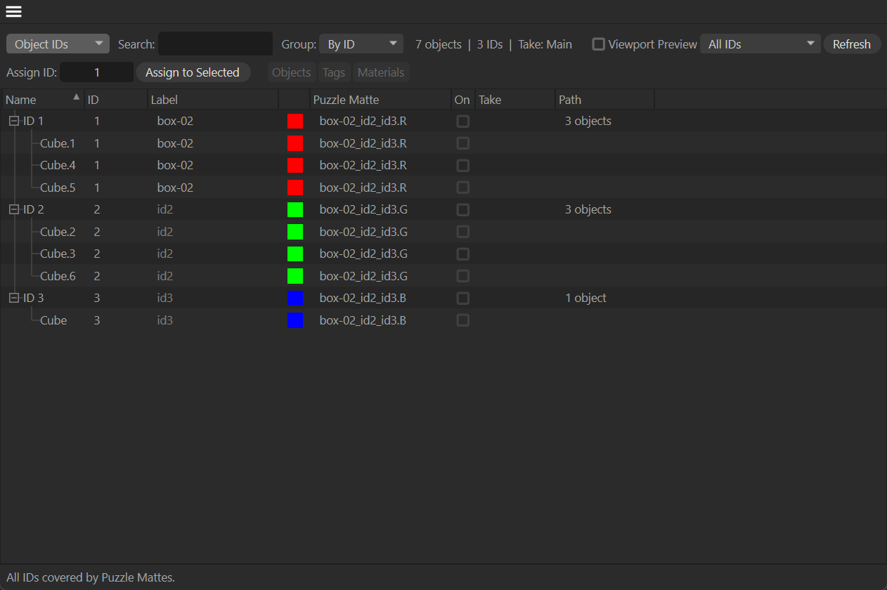

# Cinema 4D Plugins

- [Safe Delete Object](#safe-delete-object) — `SafeDeleteObject/`
- [Ease FFD](#ease-ffd) — `EaseFFD/`
- [Center Bend](#center-bend) — `CenterBend/`
- [RS ID Manager](#rs-id-manager) — `RSIDManager/`

## Safe Delete Object

`SafeDeleteObject/SafeDeleteObject.pyp` (Python command plugin, no UI)

[](https://github.com/joshvanpraag/Tools/releases/download/downloads/SafeDeleteObject.zip)

Adds a **Safe Delete Object** command (under **Extensions**) that checks what else in the scene references the selected object before deleting it, instead of deleting blind.

**What it does**

1. Scans the entire document — every object, every tag, XPresso node graphs, and the active Render Settings (sky/background/foreground/floor/camera links) — for anything that links to the selected object: instances, Boole/Symmetry/Cloner sources, Target/Constraint tags, spline references, and more.
2. If nothing references it, deletes it immediately.
3. If something does, shows a confirmation dialog listing every reference by name before deleting anything.
4. If you cancel, it instead selects the referencing object(s) in the Object Manager so you can see exactly where the object is used.
5. Children of the deleted object are **not** deleted — they're reparented one level up, matching Cinema's standard "Delete" (not "Delete With Children") behavior, so nothing downstream silently vanishes.
6. The whole operation (reparenting, render-data changes, the delete itself) is wrapped in one undo step.

**Install**

Drop the whole `SafeDeleteObject` folder into Cinema 4D's plugins directory (**Edit > Preferences > Open Preferences Folder > plugins**), then restart Cinema 4D. It appears as **Safe Delete Object** under **Extensions**.

**Usage**

Select an object and run **Extensions > Safe Delete Object** instead of the regular Delete key when you're not sure what else in the scene might be pointing at it.

**Notes**

- `PLUGIN_ID` in `SafeDeleteObject.pyp` is a personal-use placeholder. If it collides with another installed plugin, Cinema warns in the Console — pick a different ID ≥ 1000000, or register a real one at plugincafe.maxon.net before distributing.
- XPresso and Take System references are scanned on a best-effort basis — the node-graph scan is wrapped defensively since node internals vary more between Cinema 4D versions than the regular object API. Always double-check the Console after using this on a scene with complex XPresso setups.
- Render Settings references (e.g. an object set as the Sky or Background object) can't be highlighted in the Object Manager since Render Settings isn't a selectable object — the plugin tells you to check **Edit > Render Settings** directly in that case.

<br>
<br>
<br>
<br>

## Ease FFD

`EaseFFD/EaseFFD.pyp` (Python object plugin)

[](https://github.com/joshvanpraag/Tools/releases/download/downloads/EaseFFD.zip)

Adds an **Ease** slider to a Free-Form Deformation cage that blends between a sharp, local, corner-for-corner deformation and the native FFD's smooth global Bernstein/Bezier result — something stock FFD can't do at any cage density.



- **Ease = 0%** — sharp, exactly follows the cage (local trilinear interpolation across the nearest cell)
- **Ease = 100%** — identical to native FFD (same global Bernstein/Bezier math stock FFD always uses)
- **0–100%** — blend of the two
- **>100%** — allowed, extrapolates past native smoothness

Works correctly on animated geometry: it reads each frame's already-animated point cache fresh, so there's no risk of compounding deformation.

### Install

Drop the whole `EaseFFD` folder into Cinema 4D's plugins directory (**Edit > Preferences > Open Preferences Folder > plugins**), then restart Cinema 4D. It appears as **Ease FFD** wherever your plugin menu lands (e.g. Create > Object).

### Required hierarchy

**The FFD cage must be linked into the "FFD Cage" field on the Ease FFD object — that link is what matters, not where the FFD sits in the Object Manager.** Two hierarchy patterns both work:

**Simple (single object) — as pictured above:**

```
Cube
└── Ease FFD      <- child of the object it deforms
    └── FFD        <- parked here for tidy organization; linked via "FFD Cage"
```

Add **Ease FFD** as a direct child of the object you want deformed (the classic way native deformers like Bend/Twist/FFD are used), and park the FFD cage as a child of the Ease FFD object itself. Link the FFD into the **FFD Cage** field and set **Ease** to taste.

**Multi-object (siblings under a shared parent):**

```
Null
├── Tube
├── Object 1..30   <- any number of siblings, can be independently animated
└── Ease FFD       <- must be LAST, linked to the FFD below

FFD                 <- separate branch, NOT nested under the same Null
```

To deform multiple sibling objects at once (all combined, every frame, including their own animation — exactly like native FFD), put **Ease FFD** as the *last* child under a shared parent, after every object it should affect. In this pattern, keep the FFD cage in a **separate** location — its own Null, or parked at the root — rather than nested under that same parent. Keep the FFD fully **enabled**: with no preceding siblings of its own to act on, its native deformation has nothing to do, so it stays enabled (cage fully visible and live-editable) without ever double-deforming the geometry.

### Usage

1. Set up the hierarchy above and link the FFD cage into the **FFD Cage** field on the Ease FFD object.
2. Adjust **Ease** (0–300%) to blend between sharp and smooth.

### Notes

- `PLUGIN_ID` in `EaseFFD.pyp` is a personal-use placeholder. If it collides with another installed plugin, Cinema warns in the Console — pick a different ID ≥ 1000000, or register a real one at plugincafe.maxon.net before distributing.
- If deformation looks scrambled/spiky rather than smoothly wrong, the FFD's internal point ordering doesn't match the plugin's assumption — flip `FFD_ORDER` in `EaseFFD.pyp` from `0` to `1`.
- Pure Python, evaluated per-vertex per-grid-point. Keep the FFD's own grid resolution modest (5–15 points per axis) for interactive speed — the mesh resolution of the deformed object matters much less than the FFD grid size.

<br>
<br>
<br>
<br>

## Center Bend

`CenterBend/CenterBend.pyp` (Python deformer plugin)

[](https://github.com/joshvanpraag/Tools/releases/download/downloads/CenterBend.zip)

A bend deformer that wraps geometry around a cylinder **from the center outward**: the front stays flat and both ends curve back symmetrically. This is handy for wrapping text or panels around a curved surface, where native Bend only bends from one end.



The bend length runs along the deformer's local X, the cylinder axis is local Y, and the ends curve toward local +Z (away from a default camera). Text built in the XY plane needs no rotation.

### Install

Drop the whole `CenterBend` folder into Cinema 4D's plugins directory (**Edit > Preferences > Open Preferences Folder > plugins**), then restart Cinema 4D. It appears as **Center Bend** wherever your plugin menu lands (e.g. Create > Object).

### Usage

Add **Center Bend** as a child of the object you want to deform, the same way you'd use native Bend.

- **Auto Fit**: measures the incoming geometry in the deformer's own space on every cook, so it fits at any orientation.
- **Fit to Parent**: bakes the current measurement into **Size**, moves the deformer to center it on the geometry, and turns Auto Fit off.
- **Size**: the bend region, used when Auto Fit is off.
- **Mode**: what happens to geometry past the ends of the region. **Limited** continues straight along the end tangent, and **Unlimited** keeps curving.
- **Angle**: total wrap angle across both sides (e.g. 180° wraps into a half cylinder, 360° into a full one).
- **Center Offset**: slides the center of the bend left or right (±50% of the length).
- **Flat Zone**: percentage of the length kept undeformed at the front.
- **Falloff**: how gradually the curve eases in from the flat zone to full bend.
- **Y Offset** and **Y Direction**: shift the ends along Y as they wrap. **Both Ends Same** lifts both ends the same way. **Opposite (Spiral)** lifts one end and lowers the other, which makes a helix.

### Notes

- `PLUGIN_ID` in `CenterBend.pyp` is a personal-use placeholder. If it collides with another installed plugin, Cinema warns in the Console. Pick a different ID ≥ 1000000, or register a real one at plugincafe.maxon.net before distributing.

<br>
<br>
<br>
<br>

## RS ID Manager

`RSIDManager/RSIDManager.pyp` (Python command plugin, dockable panel)

[](https://github.com/joshvanpraag/Tools/releases/download/downloads/RSIDManager.zip)

A dockable panel that lists every Redshift Object ID or Material ID in the scene in one table, along with the Puzzle Matte that covers it, so you can see and fix ID assignments without clicking through tags and materials one at a time.



**What it does**

- **Grouped table.** Switch between **Object IDs** (objects with a Redshift Object tag) and **Material IDs** (Redshift node materials). Rows are grouped by ID, or shown flat with **Group: None**. Columns sort when you click their headers, and **Search** filters by name, path or label.
- **Puzzle Matte coverage.** Each row shows a swatch and the matte channel that picks up its ID (e.g. `box-02_id2_id3.R`). The status bar warns about IDs that no Puzzle Matte covers, matte channels that point at an ID nothing uses, and IDs that appear in more than one matte.
- **Labels synced to Puzzle Matte names.** Give an ID a readable label (e.g. `box-02`) and every Puzzle Matte that uses that ID is renamed from its labels, with channels joined by `_` (e.g. `box-02_id2_id3`). IDs without a label show as `id<N>`. Labels are saved in the scene. When you change a matte's IDs in Render Settings, its name updates automatically.
- **Viewport preview.** **Viewport Preview** switches the viewports to flat shading and colors objects with their matte channel's color (red, green or blue) for the rows you select. Unselected objects are dimmed, and IDs no matte covers show orange. Choose a single Puzzle Matte from the dropdown next to it to see just that matte. Turning the preview off restores the objects' display colors and the viewport settings.
- **Drag to reassign.** Drag objects (or materials) from the Object or Material Manager, or rows from the table, onto an ID's row to move them to that ID.
- **Two-way selection sync.** Selecting rows selects the matching items in the scene, and selecting items in the scene highlights their rows. The **Objects** / **Tags** / **Materials** toggles choose what a table selection selects: objects or their Redshift tags in Object ID mode, materials or the objects using them in Material ID mode.
- **Take awareness.** The current take is shown at the top. When Auto Take is on in a take other than Main, ID changes are recorded as take overrides instead of changing the base scene. The **Take** column marks tags overridden in the current take (**override**) or only in other takes (**varies**).

ID, override and Puzzle Matte name changes are each one undo step.

**Install**

Drop the whole `RSIDManager` folder into Cinema 4D's plugins directory (**Edit > Preferences > Open Preferences Folder > plugins**), then restart Cinema 4D. It appears as **RS ID Manager** under **Extensions**, and the panel can be docked into any layout.

**Usage**

1. Open **Extensions > RS ID Manager** and pick **Object IDs** or **Material IDs**.
2. To assign an ID, select rows and either type a number in **Assign ID** and click **Assign to Selected**, or double-click an ID cell (or a group row) and enter a new ID.
3. To label an ID, double-click its **Label** cell. Leave the field empty and click OK to clear the label.
4. In Object ID mode, the **On** checkbox turns a tag's Object ID override on or off. Rows with the override off are grouped under **Override off**.
5. Right-click the table to **Fold All** or **Unfold All** groups.
6. Click **Refresh** to rescan the scene and rename every Puzzle Matte from the current labels.

**Notes**

- Requires Redshift. Puzzle Matte checks are skipped if Redshift isn't the active renderer.
- Material ID mode only lists Redshift node materials. Other materials are counted in the status bar but not shown.
- `PLUGIN_ID` in `RSIDManager.pyp` is a personal-use placeholder. If it collides with another installed plugin, Cinema warns in the Console. Pick a different ID ≥ 1000000, or register a real one at plugincafe.maxon.net before distributing.
